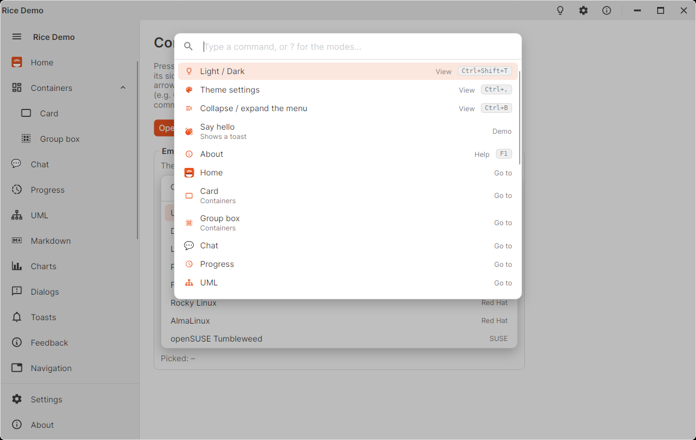
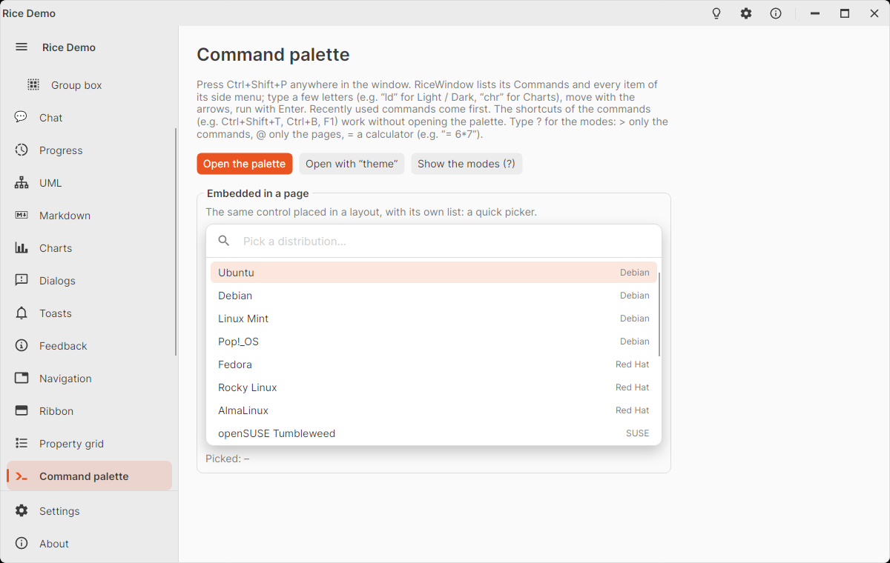

# RiceCommandPalette

Search box over the commands of the application, like the command palette of code editors. Typing filters and ranks the
commands (fuzzy: "ld" finds "Light / Dark", the matched letters are highlighted), the arrow keys move the selection,
Enter runs the selected command, Escape closes. Recently used commands come first.

<picture>
  <source media="(prefers-color-scheme: dark)" srcset="images/command-palette-open-dark.png" />
  
</picture>

<picture>
  <source media="(prefers-color-scheme: dark)" srcset="images/command-palette-dark.png" />
  
</picture>

## In a RiceWindow

A `RiceWindow` opens the palette with **Ctrl+Shift+P**. It lists the window's `Commands` and – with
`IncludeNavigationCommands` (default) – every item of its `RiceSideMenu` under "Go to", so the pages are reachable from
the keyboard without any extra code.

```csharp
Commands.Add(new RiceCommandItem("Toggle light / dark", ThemeManager.Instance.ToggleVariant)
{
    Icon = MaterialIconKind.LightbulbOutline,
    Category = "View",
    Keywords = "dark light mode",
    Gesture = new KeyGesture(Key.T, KeyModifiers.Control | KeyModifiers.Shift),
});
Commands.Add(new RiceCommandItem { Title = "Save", Command = viewModel.SaveCommand, Gesture = KeyGesture.Parse("Ctrl+S") });
```

`RiceCommandItem` is a plain class (not a control), so set it up in code – XAML bindings cannot target it.

The `Gesture` of a command is shown in the palette **and** runs the command in the whole window, also while the palette
is closed. Open the palette from code with `window.ShowCommandPalette()` or `ShowCommandPalette("theme")` (pre-filled).
Change the shortcut with `CommandPaletteGesture` (`null` turns it off). Override `GetPaletteCommands(navigation)` or
`GetPaletteProviders(navigation)` in a subclass to build the lists differently (e.g. context dependent commands).

## Modes (prefixes)

Typing a prefix first switches the palette to a mode that searches only its own entries; the mode is shown on the right
of the search box. Typing `?` lists the modes, and choosing one types its prefix. A `RiceWindow` has two built in:

| Prefix | Mode |
|--------|------|
| `>` | Only the window's `Commands` |
| `@` | Only the side menu items (with `IncludeNavigationCommands`) |

Add your own to `CommandProviders`, with a fixed list or entries computed from the text after the prefix:

```csharp
// "#42" → "Go to line 42"
CommandProviders.Add(new RiceCommandProvider
{
    Prefix = "#",
    Title = "Go to line",
    Icon = MaterialIconKind.FormatListNumbered,
    FilterResults = false,
    GetCommands = text => int.TryParse(text, out var line)
        ? [new RiceCommandItem($"Go to line {line}", () => editor.GoToLine(line))]
        : [],
});

// "% ubuntu" → search a fixed list
CommandProviders.Add(new RiceCommandProvider("%", "Recent files", recentFiles.Select(f => new RiceCommandItem(f, () => Open(f)))));
```

| `RiceCommandProvider` | Description |
|-----------------------|-------------|
| `Prefix` | Text that starts the mode (one or more characters, no spaces). The longest matching prefix wins. |
| `Title`, `Icon` | Shown in the `?` list and as the mode label. |
| `Commands` | The entries, when `GetCommands` is not set. |
| `GetCommands` | `Func<string, IEnumerable<RiceCommandItem>>`: builds the entries from the text after the prefix (trimmed) on every change. |
| `FilterResults` | `true` (default): rank the entries by the text after the prefix; `false`: list them as returned. |

Without modes `?` is an ordinary search text. An entry with `KeepOpen = true` runs without closing the palette (the `?`
list uses it to switch modes).

## Over any window

```csharp
RiceCommandPalette.Show(commands, owner: this, query: null);
RiceCommandPalette.Show(commands, providers, owner: this);   // with modes
RiceCommandPalette.Hide(this);
bool open = RiceCommandPalette.IsShown(this);
```

The palette is shown in the window's overlay layer, centered near the top, on a dimmed backdrop; a click on the backdrop
closes it, and the focus goes back where it was. Each window keeps its palette, so the recent commands are remembered
while the application runs.

## Embedded

The control can also be placed in a layout, e.g. as a quick picker. Embedded, choosing an entry raises `CommandInvoked`
and runs it, but the palette stays where it is.

```xml
<rice:RiceCommandPalette Commands="{Binding Distros}" Width="NaN" Height="300"
                         Placeholder="Pick a distribution…" CommandInvoked="OnPicked" />
```

## RiceCommandItem

| Property | Description |
|----------|-------------|
| `Title` | Main text; the search matches it first and highlights the matched letters. |
| `Description` | Muted second line. |
| `Category` | Muted text on the right ("View", "File", "Go to"). |
| `Icon` | `IImage`, `MaterialIconKind`, string (e.g. emoji) or any control. |
| `Gesture` | `KeyGesture` shown as the shortcut (and run by a `RiceWindow`). |
| `Keywords` | Extra search terms that are not shown, e.g. synonyms. |
| `Command`, `CommandParameter` | Run when chosen. While `Command.CanExecute` is false the entry is dimmed and cannot run. |
| `Execute` | `Action` run when chosen (before `Command`); the `(title, execute)` constructor sets it. |
| `KeepOpen` | Runs the entry without closing the palette. |

Category, keywords and description are searched too, but count less than the title. Every word of the query must match
somewhere ("theme set" finds "Theme settings").

## RiceCommandPalette

| Member | Default | Description |
|--------|---------|-------------|
| `Commands` | `null` | The entries. |
| `Providers` | `null` | The modes (`RiceCommandProvider`s). |
| `CurrentMode` | | The provider whose prefix the query starts with; `null` otherwise. |
| `Query` | `""` | Text of the search box (two-way bindable). |
| `Placeholder` | `RiceStrings.CommandPalettePlaceholder` | Shown in the empty search box. |
| `MaxResults` | `50` | Number of entries listed at most. |
| `Matches` | | The ranked results (`RiceCommandMatch`: `Command`, `Score`, `Highlights`, `IsEnabled`). |
| `SelectedMatch` | | The highlighted result. |
| `RecentCommands` | | The commands run from this palette, most recent first. |
| `Invoke(match)` | | Runs a result (default: the selected one). |
| `FocusSearchBox(selectAll)` | | Focuses the search box and selects its text (or puts the caret after it). |
| `CommandInvoked` event | | A command was chosen, before it runs. |
| `CloseRequested` event | | A command was chosen or Escape was pressed. |

PageUp / PageDown move by a page; Up on the first entry wraps to the last one.

## Styling

Brushes: `RiceBackdropBrush` (dimmed window), `RicePopupShadow`, `RiceHoverBrush`, `RiceSelectedRowBrush`. The palette is
600 px wide and at most 460 px high by default (`Width`, `MaxHeight`). Texts: `RiceStrings.CommandPalettePlaceholder`,
`CommandPalettePlaceholderWithModes`, `CommandPaletteNoResults`, `CommandPaletteNavigation`, `CommandPaletteCommandsMode`,
`CommandPaletteNavigationMode`.
