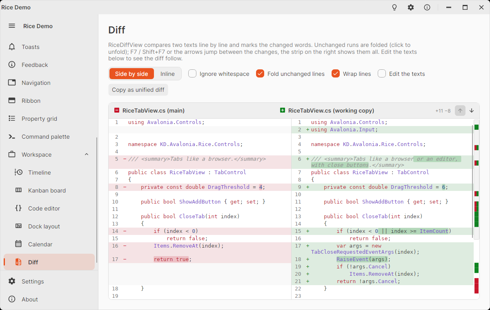

# RiceDiffView

Shows the difference of two texts like the diff of a code review: the removed lines in red, the added ones in green,
and inside a changed line the changed words in a stronger shade. Long unchanged runs are folded to a few lines of
context, a strip on the right shows where the changes are in the whole text, and F7 / Shift+F7 jump between them.

<picture>
  <source media="(prefers-color-scheme: dark)" srcset="images/diff-dark.png" />
  
</picture>

```xml
<!-- xmlns:diff="clr-namespace:KD.Avalonia.Rice.Controls.Diffs;assembly=KD.Avalonia.Rice" -->
<diff:RiceDiffView OldText="{Binding Committed}" NewText="{Binding WorkingCopy}" Language="cs"
                   OldHeader="App.axaml.cs (HEAD)" NewHeader="App.axaml.cs" />

<diff:RiceDiffView OldText="{Binding Before}" NewText="{Binding After}" ViewMode="Inline" ContextLines="-1" />
```

- **Side by side** (`ViewMode="SideBySide"`, the default): the old text on the left, the new one on the right; a line
  that replaced another stands next to it, the side without a line is shaded.
- **Inline**: one column with both line numbers; the removed lines come first, then the added lines that replace them.

The lines are compared with Myers' algorithm (the one of `git diff`). Removed and added lines next to each other are a
change: their lines are paired in order and compared word by word, when they have enough in common. `Language` colors
the code like the Markdown code blocks (`cs`, `xaml`, `json`, `js`, `py`, `bash`, `sql`, `yaml`, …). The rows are
virtualized, so long files scroll smoothly; a new text is compared again after the property changed (both texts and
the language changing together are compared once).

## Navigating

- The arrows in the header, F7 / Shift+F7 or Alt+↓ / Alt+↑ jump to the next / previous change; the current change gets
  an accent bar on the left. From code: `NextChange()`, `PreviousChange()`, `GoToChange(index)`, `CurrentChange`.
- A folded run shows "⋯ n unchanged lines": click it to show the lines (`ExpandFold(row)`); `CollapseFolds()` folds
  everything again.
- Click or drag on the strip on the right to scroll there; the box on it is the visible part.

## Properties

| Member | Default | Description |
|--------|---------|-------------|
| `OldText` / `NewText` | `null` | The two texts (`\n` or `\r\n` line breaks). |
| `OldHeader` / `NewHeader` | `null` | Titles above the sides; null: "Original" / "Modified". Inline: "old → new". |
| `Language` | `null` | Language of the syntax colors. |
| `ViewMode` | `SideBySide` | `SideBySide` or `Inline`. |
| `IgnoreWhitespace` | `false` | Lines that differ only in their whitespace (indentation, spaces) count as equal. |
| `ContextLines` | `3` | Unchanged lines kept around a change; `-1` folds nothing. |
| `WrapLines` | `true` | Wraps long lines; `false` cuts them at the edge. |
| `CodeFontFamily` / `CodeFontSize` | monospace / `13` | Font of the lines. |
| `Statistics` | | Read only: "+12 −3", the added and removed lines (also in the header). |
| `Document` | | Read only: the computed `DiffDocument` (blocks, lines, counts). |
| `ToUnifiedDiff()` | | The difference in the unified format of `diff -u` / `git diff`, e.g. to copy or save as a patch. |

Without a view, `DiffDocument.Compute(oldText, newText, ignoreWhitespace)` gives the same result
(`Blocks`, `AddedLines`, `RemovedLines`, `ChangeCount`, `IsIdentical`, `BuildRows(...)`, `ToUnifiedDiff(...)`), and
`DiffAlgorithm.Diff(old, new)` compares any two sequences. Over 2000 edits the comparison stops and reports the rest as
one replacement, to keep the memory use in bounds.

## Styling

Brushes: `RiceDiffAddedBrush` / `RiceDiffRemovedBrush` (lines), `RiceDiffAddedWordBrush` / `RiceDiffRemovedWordBrush`
(changed words), `RiceDiffAddedMarkBrush` / `RiceDiffRemovedMarkBrush` (signs, header icons and the overview strip),
`RiceDiffEmptyBrush` (the empty side, folds), and the `RiceCode…Brush` syntax colors. Pseudo classes of the view:
`:inline`, `:identical`. Texts: `RiceStrings.DiffOriginal`, `DiffModified`, `DiffPreviousChange`, `DiffNextChange`,
`DiffIdentical`, `DiffHiddenLines`.
