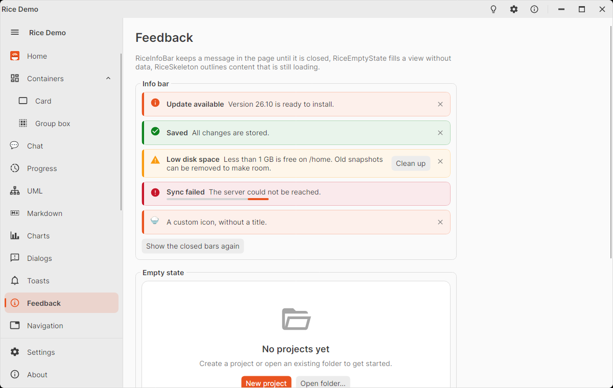

# RiceInfoBar

Message bar that stays in the layout of a page until it is closed – unlike a [toast](rice-toast.md), which floats over
the window and closes itself. A strip tinted with the color of its kind, an icon, a bold title flowing into the message,
optional custom content, an optional action on the right and a close button.

<picture>
  <source media="(prefers-color-scheme: dark)" srcset="images/feedback-dark.png" />
  
</picture>

```xml
<rice:RiceInfoBar Title="Update available" Message="Version 26.10 is ready to install." />

<rice:RiceInfoBar Kind="Warning" Title="Low disk space" Message="Less than 1 GB is free on /home.">
  <rice:RiceInfoBar.Action>
    <Button Content="Clean up" Command="{Binding CleanUpCommand}" />
  </rice:RiceInfoBar.Action>
</rice:RiceInfoBar>

<rice:RiceInfoBar Kind="Error" Title="Sync failed" Message="The server could not be reached." IsClosable="False">
  <ProgressBar IsIndeterminate="True" />
</rice:RiceInfoBar>
```

Show and hide it by binding `IsOpen`:

```xml
<rice:RiceInfoBar Kind="Success" Message="Saved." IsOpen="{Binding ShowSaved}" />
```

## Properties

| Property | Default | Description |
|----------|---------|-------------|
| `Kind` | `Info` | `Info` (accent), `Success` (green), `Warning` (amber), `Error` (danger red): sets the colors and the icon. |
| `Title` | `null` | Bold text in front of the message. |
| `Message` | `null` | The text; title and message wrap as one paragraph. |
| `Content` | `null` | Extra content below the text, e.g. a progress bar or a link. |
| `Action` | `null` | Content on the right, before the close button, e.g. a button. |
| `IsOpen` | `true` | Shows the bar; the close button sets it to `false` (two-way bindable). |
| `IsClosable` | `true` | Shows the close button. |
| `Icon` | `null` | Replaces the icon of the kind: `IImage`, `MaterialIconKind`, string (e.g. emoji) or any control. |
| `ShowIcon` | `true` | `false` hides the icon. |

## Methods and events

| Member | Description |
|--------|-------------|
| `Close()` | Same as the close button: sets `IsOpen` to `false`. |
| `Closed` event | Raised when `IsOpen` becomes `false` (by the button or by code). |

## Styling

The bar uses the toast brushes of its kind (`RiceToastInfoBrush`, `RiceToastInfoBackgroundBrush`,
`RiceToastInfoBorderBrush`, … `Success`, `Warning`, `Error`), so an info bar and a toast of the same kind look alike.
Pseudo classes: `:info`, `:success`, `:warning`, `:error`, `:open`, `:custom-icon`. The close button's tooltip is
`RiceStrings.InfoBarClose`. Screen readers announce the bar when it appears (errors interrupt).
