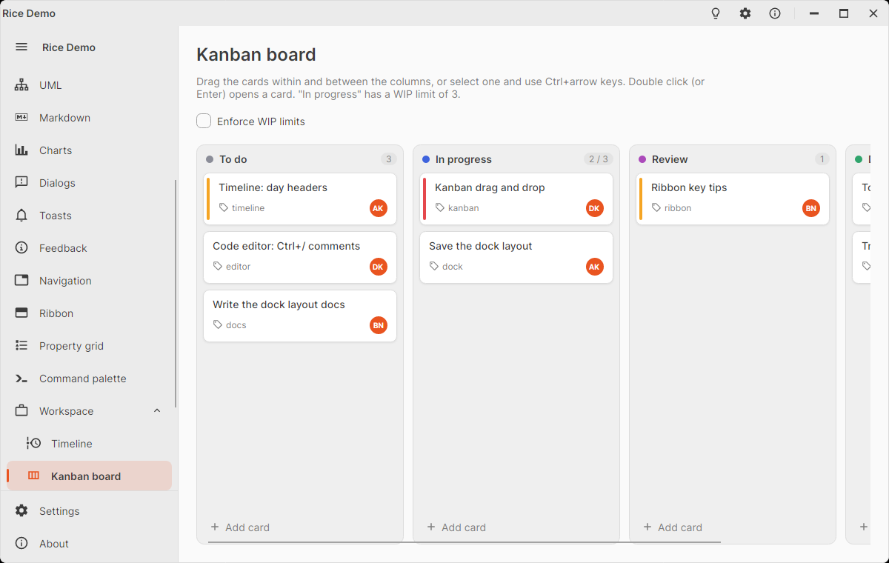

# RiceKanbanBoard

Kanban board: columns side by side (`RiceKanbanColumn`) with cards (`RiceKanbanCard`) that are dragged within and
between the columns. While dragging, a picture of the card follows the pointer, the card's place stays faded, and a line
shows where it will land. The board scrolls sideways, a column scrolls down, both also while dragging near their edge.

<picture>
  <source media="(prefers-color-scheme: dark)" srcset="images/kanban-dark.png" />
  
</picture>

```xml
<rice:RiceKanbanBoard ShowAddCardButton="True" AddCardRequested="OnAddCard" CardMoved="OnCardMoved">
  <rice:RiceKanbanColumn Header="To do" ItemsSource="{Binding Todo}" />
  <rice:RiceKanbanColumn Header="In progress" ItemsSource="{Binding Doing}" WipLimit="3" Accent="RoyalBlue" />
  <rice:RiceKanbanColumn Header="Done" ItemsSource="{Binding Done}" />
  <rice:RiceKanbanBoard.CardTemplate>
    <DataTemplate x:DataType="vm:TaskViewModel">
      <TextBlock Text="{Binding Title}" TextWrapping="Wrap" />
    </DataTemplate>
  </rice:RiceKanbanBoard.CardTemplate>
</rice:RiceKanbanBoard>
```

The columns from data too: a `TreeDataTemplate` as `ItemTemplate` gives the header of a column and its cards (its
`ItemsSource`); the column's other properties come from a style:

```xml
<rice:RiceKanbanBoard ItemsSource="{Binding Columns}">
  <rice:RiceKanbanBoard.Styles>
    <Style Selector="rice|RiceKanbanColumn" x:DataType="vm:ColumnViewModel">
      <Setter Property="WipLimit" Value="{Binding WipLimit}" />
    </Style>
    <Style Selector="rice|RiceKanbanCard" x:DataType="vm:TaskViewModel">
      <Setter Property="Accent" Value="{Binding PriorityBrush}" />
    </Style>
  </rice:RiceKanbanBoard.Styles>
  <rice:RiceKanbanBoard.ItemTemplate>
    <TreeDataTemplate x:DataType="vm:ColumnViewModel" ItemsSource="{Binding Cards}">
      <TextBlock Text="{Binding Title}" />
    </TreeDataTemplate>
  </rice:RiceKanbanBoard.ItemTemplate>
  <rice:RiceKanbanBoard.CardTemplate>
    <DataTemplate x:DataType="vm:TaskViewModel">
      <TextBlock Text="{Binding Title}" TextWrapping="Wrap" />
    </DataTemplate>
  </rice:RiceKanbanBoard.CardTemplate>
</rice:RiceKanbanBoard>
```

## Swimlanes

A board can also be split into lanes (swimlanes), e.g. one per assignee: every lane (`RiceKanbanLane`) is a header bar
over its own row of columns, and a card is dragged to any column of any lane. `LaneTemplate` turns the items of the
board into lanes: a `TreeDataTemplate` gives the header of a lane and its columns (its `ItemsSource`), while
`ItemTemplate` still gives the cards of a column. `ColumnHeaders` puts a header row above the lanes, so the columns can
hide their own headers with `ShowColumnHeaders="False"`:

```xml
<rice:RiceKanbanBoard ItemsSource="{Binding People}" ColumnHeaders="{Binding Statuses}" ShowColumnHeaders="False"
                      CardMoved="OnCardMoved">
  <rice:RiceKanbanBoard.ColumnHeaderTemplate>
    <DataTemplate x:DataType="vm:StatusViewModel">
      <TextBlock Text="{Binding Title}" />
    </DataTemplate>
  </rice:RiceKanbanBoard.ColumnHeaderTemplate>
  <rice:RiceKanbanBoard.LaneTemplate>
    <TreeDataTemplate x:DataType="vm:PersonViewModel" ItemsSource="{Binding Columns}">
      <TextBlock Text="{Binding Name}" />
    </TreeDataTemplate>
  </rice:RiceKanbanBoard.LaneTemplate>
  <rice:RiceKanbanBoard.ItemTemplate>
    <TreeDataTemplate x:DataType="vm:ColumnViewModel" ItemsSource="{Binding Cards}">
      <TextBlock Text="{Binding Title}" />
    </TreeDataTemplate>
  </rice:RiceKanbanBoard.ItemTemplate>
  <rice:RiceKanbanBoard.CardTemplate>
    <DataTemplate x:DataType="vm:TaskViewModel">
      <TextBlock Text="{Binding Title}" TextWrapping="Wrap" />
    </DataTemplate>
  </rice:RiceKanbanBoard.CardTemplate>
</rice:RiceKanbanBoard>
```

`RiceKanbanLane`s can be declared in XAML too, each holding `RiceKanbanColumn`s. The lanes are stacked and scroll
down together (also while dragging near the top or bottom edge); a column of a lane grows with its cards instead of
scrolling. The chevron of a lane collapses it. In the move events `e.SourceLane` / `e.TargetLane` (and
`column.Lane`) give the lanes; a WIP limit counts the cards of one column of one lane.

The header row holds `RiceKanbanColumnHeader`s 280 pixels wide, like the columns: a style that changes the `Width` of
`RiceKanbanColumn` should change theirs too.

## Moving cards

A card is moved by dragging it (Escape cancels the drag), or by the keyboard on the selected card: Ctrl+←/→ moves it to
the previous / next column, Ctrl+↑/↓ within its column. The arrow keys alone move the selection. With lanes, ←/→ stay in
the lane, while ↑/↓ (and Ctrl+↑/↓) go on into the same column of the expanded lane above / below at the first / last
card.

1. `CardMoving` is raised (`e.Item`, `e.SourceColumn`, `e.SourceIndex`, `e.TargetColumn`, `e.TargetIndex`). Set
   `e.Cancel = true` to keep the card (e.g. a rule of your workflow), or `e.Handled = true` to move it yourself
   (e.g. by changing the task's status, which moves it in your view model).
2. Otherwise the item is removed from the source column's `Items` or modifiable `IList` source (an
   `ObservableCollection`) and inserted into the target's.
3. `CardMoved` is raised, the card is selected and focused.

`MoveCard(source, index, target, targetIndex)` does the same from code (`targetIndex` counts the cards before the move).
Moving needs `Items` or a modifiable `IList` on both sides, and an item the target collection accepts.

With `EnforceWipLimits="True"` no card can be moved into a column that has as many cards as its `WipLimit` (the column
turns red while a card is dragged over it). Without it, the limit is only shown: the count reads "3 / 3" in amber at the
limit and red over it. A column with `AllowDrop="False"` takes no cards from other columns.

## Properties and events

`RiceKanbanBoard`:

| Member | Default | Description |
|--------|---------|-------------|
| `CardTemplate` | `null` | Template of the data cards of every column (a column's own `ItemTemplate` wins). |
| `CanDragCards` | `true` | Lets the cards be dragged and moved with Ctrl+arrow keys. |
| `EnforceWipLimits` | `false` | Refuses to move cards into full columns. |
| `ShowAddCardButton` | `false` | An "Add card" button at the bottom of every column; raises `AddCardRequested` (`e.Column`). |
| `LaneTemplate` | `null` | Makes the items lanes; a `TreeDataTemplate` gives the header and the columns of a lane. |
| `ColumnHeaders` / `ColumnHeaderTemplate` | `null` | A header row above the lanes, one item per column. |
| `ShowColumnHeaders` | `true` | The header (title, count, actions) of every column. |
| `SelectedCard` | `null` | The item of the selected card (two way). |
| `Columns` | | The column containers, in order (lane by lane). |
| `Lanes` / `HasLanes` | | The lane containers, in order / whether the items are lanes. |
| `CardMoving` / `CardMoved` events | | See above. |
| `CardActivated` event | | Double click or Enter on a card (`e.Item`, `e.Column`), e.g. to open it. |
| `CanDropInto(column)` | | Whether a card from another column may be dropped into it. |

`RiceKanbanColumn` (a `HeaderedItemsControl`):

| Property | Default | Description |
|----------|---------|-------------|
| `Header` | | Title of the column. |
| `Icon` | `null` | `IImage`, `MaterialIconKind`, string or control before the title. |
| `Accent` | `null` | Color of a dot before the title. |
| `WipLimit` | `0` | Work in progress limit; `0` = none. |
| `HeaderActions` | `null` | Content at the right of the header, e.g. a menu button. |
| `AllowDrop` | `true` | Takes cards from other columns. |
| `CountText` | | Read only: "3" or "3 / 5". |
| `Width` | `280` | Width of the column. |

`RiceKanbanLane` (a `HeaderedItemsControl` of columns): `Header`, `IsExpanded` (`true`, two way), `HeaderActions`,
`CountText` (the cards of all its columns, read only).

`RiceKanbanCard` (a `ContentControl`): `Accent` (a colored stripe on the left, e.g. the priority), `IsSelected`.
Buttons and text boxes on a card keep working: a press on them does not start a drag.

## Styling

`RiceKanbanBoard` pseudo class: `:lanes`. `RiceKanbanLane`: `:collapsed`, `:empty`. `RiceKanbanColumn` pseudo classes: `:empty`, `:at-limit`, `:over-limit`, `:drop-target` (a dragged card would land
here), `:drop-refused`. `RiceKanbanCard`: `:selected`, `:dragging` (the place of the dragged card), `:has-accent`.
Columns and column headers use `RiceTrackBrush`, cards `RiceSurfaceBrush` with `RiceCardShadow1` (`RiceCardShadow2` under the pointer),
the picture of a dragged card `RicePopupShadow`. Texts: `RiceStrings.KanbanAddCard`, `RiceStrings.KanbanEmptyColumn`.
