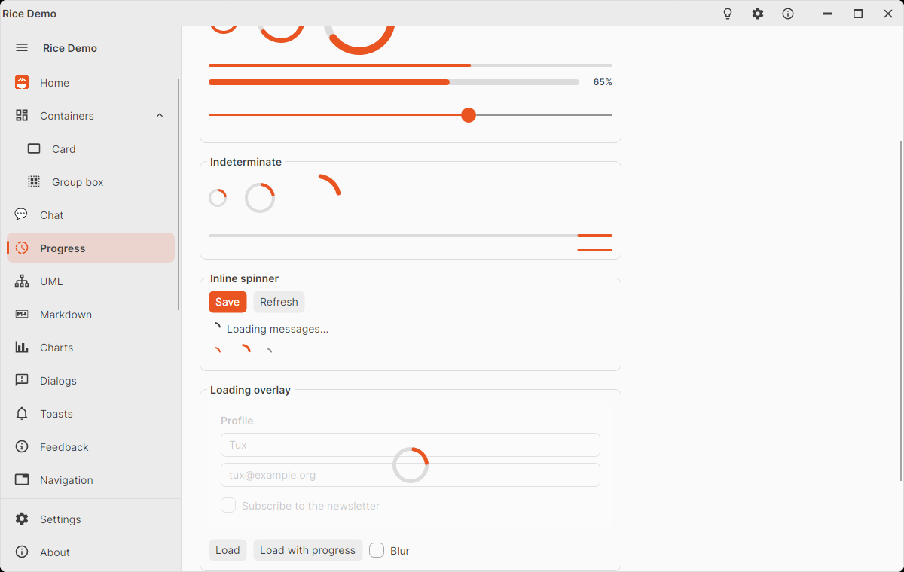

# RiceLoadingOverlay

Wraps any content (a form, a list, a whole page) and, while `IsActive` is true, covers it with a translucent layer
showing a [`RiceProgressRing`](rice-progress-ring.md) and an optional message. Meanwhile the covered content gets
**no pointer and no keyboard input** (clicks, typing, Tab, Enter are swallowed), so the user cannot change data that is
being loaded or saved. The layer fades in and out.

<picture>
  <source media="(prefers-color-scheme: dark)" srcset="images/loading-overlay-dark.png" />
  
</picture>

```xml
<rice:RiceLoadingOverlay IsActive="{Binding IsLoading}" Message="Loading profile…">
  <StackPanel Spacing="8">
    <TextBox Text="{Binding Name}" />
    <TextBox Text="{Binding Email}" />
  </StackPanel>
</rice:RiceLoadingOverlay>
```

With real progress:

```xml
<rice:RiceLoadingOverlay IsActive="{Binding IsUploading}" IsIndeterminate="False" Value="{Binding UploadPercent}"
                         Message="Uploading…">
  ...
</rice:RiceLoadingOverlay>
```

## Properties

| Property | Default | Description |
|----------|---------|-------------|
| `Content` | – | The covered content. |
| `IsActive` | `false` | Shows the overlay and blocks the content. |
| `Message`, `MessageTemplate` | `null` | Text (or any content) below the ring; semi-bold, wraps at 320 px. |
| `IsIndeterminate` | `true` | Spinning ring; `false` shows `Value`. |
| `Value` | `0` | Progress 0–100 when not indeterminate. |
| `ShowValue` | `true` | Percentage in the ring (determinate only). |
| `IndicatorSize` | `48` | Width and height of the ring. |
| `OverlayBrush` | `RiceOverlayBrush` | The covering layer (the theme background, translucent). |
| `BlurContent` | `false` | Blurs the covered content while active. |
| `CornerRadius` | `0` | Rounds the layer (and the content background); match it to the content, e.g. a card. |
| `Background`, `Padding` | – | Background and padding of the content area. |

## Examples

A whole page while it loads, with blur:

```xml
<rice:RiceLoadingOverlay IsActive="{Binding IsLoading}" Message="{Binding LoadingText}" BlurContent="True">
  <local:OrdersView />
</rice:RiceLoadingOverlay>
```

On a card: give the overlay the card's corner radius, so the layer does not stick out at the corners.

```xml
<rice:RiceCard Header="Profile" Padding="0">
  <rice:RiceLoadingOverlay IsActive="{Binding IsSaving}" Message="Saving…" CornerRadius="0,0,12,12" Padding="16">
    <StackPanel Spacing="8"> ... </StackPanel>
  </rice:RiceLoadingOverlay>
</rice:RiceCard>
```

From code:

```csharp
Overlay.Message = "Loading profile…";
Overlay.IsActive = true;
try
{
    await LoadProfileAsync();
}
finally
{
    Overlay.IsActive = false;
}
```

A darker, modal like layer:

```xml
<rice:RiceLoadingOverlay OverlayBrush="#99000000" Foreground="White" ... />
```

## Notes

- The ring only spins while the overlay is active, so an idle overlay costs nothing.
- Input is blocked for the overlay's own content only; the rest of the window keeps working. Wrap the window content
  to block everything.
- Keyboard focus stays where it was (e.g. in a text box), but the keys do not reach it until the overlay closes.
- `BlurContent` uses a blur effect, which is more expensive to draw on large content.

## Styling

Pseudo class: `:active`. Template parts: `PART_ContentPresenter`, `PART_Overlay` (the layer, a `Border`),
`PART_Ring` (`RiceProgressRing`, `Thickness` 5), `PART_MessagePresenter`. Brush: `RiceOverlayBrush`.
