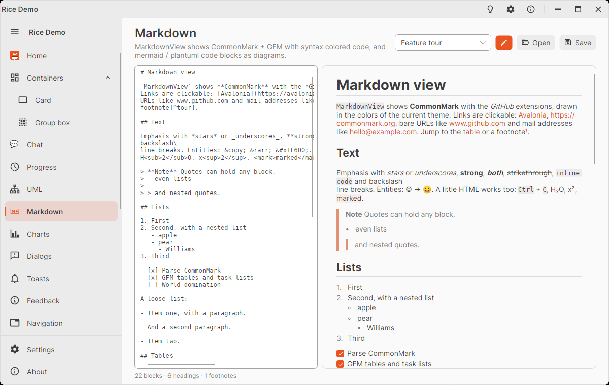
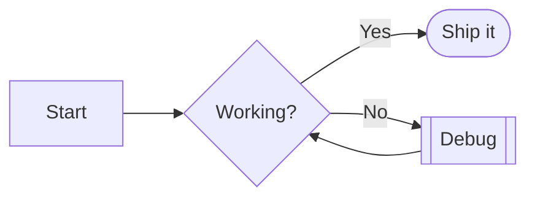

# Markdown and Mermaid (MarkdownView, MermaidView)

`MarkdownView` shows Markdown text in the colors of the current Rice theme: GitHub style headings, lists and task
lists, quotes, tables, syntax colored code blocks with a copy button, images, footnotes – and `mermaid` and
`plantuml` code blocks drawn as diagrams. `MermaidView` shows one Mermaid diagram with pan, zoom and selection, like
[`UmlDiagramView`](rice-uml.md).

<picture>
  <source media="(prefers-color-scheme: dark)" srcset="images/markdown-dark.png" />
  
</picture>

Everything is built in: no external package, no browser, no JavaScript. The Markdown parser follows the
[CommonMark](https://commonmark.org) spec with the GitHub (GFM) extensions; the diagrams use the layout and drawing
engine of the UML controls.

```xml
xmlns:md="clr-namespace:KD.Avalonia.Rice.Controls.Markdowns;assembly=KD.Avalonia.Rice"
```

```xml
<md:MarkdownView Markdown="{Binding ReadmeText}" BaseUri="avares://MyApp/Docs/" />

<md:MermaidView Source="{Binding FlowchartText}" />
```

```csharp
// a file: relative images and links are resolved from its folder
DocView.BaseUri = new Uri(Path.GetFullPath("docs/setup.md"));
DocView.Markdown = File.ReadAllText("docs/setup.md");

// links: anchors scroll and URLs open in the browser, unless a handler takes them
DocView.LinkClicked += (_, e) =>
{
    if (e.Url.EndsWith(".md"))
    {
        DocView.Markdown = File.ReadAllText(e.Uri!.LocalPath);
        e.Handled = true;
    }
};

// the parsed document, e.g. for a table of contents
foreach (var heading in DocView.Document!.Headings)
    Console.WriteLine($"{new string(' ', heading.Level * 2)}{heading.PlainText} → #{heading.Slug}");
```

## MarkdownView

| Property | Default | Description |
|----------|---------|-------------|
| `Markdown` | `null` | The Markdown text; setting it parses and shows it (the scroll position stays, handy for a live preview). |
| `Document` | – | Read-only, the `MarkdownDocument` parsed from `Markdown`. |
| `BaseUri` | `null` | Base of relative image paths and links, e.g. the path of the file or `avares://MyApp/Docs/`. |
| `IsTextSelectionEnabled` | `true` | Text can be selected and copied (within a paragraph, cell or code block). |
| `RenderDiagrams` | `true` | `mermaid` and `plantuml` code blocks as diagrams, `chart` blocks as [charts](rice-charts.md#charts-in-markdown); `false` shows them as code. |
| `MaxDiagramHeight` | `560` | Diagrams are scaled down to fit this height and the width of the text. |
| `ContentMaxWidth` | `900` | Width of the text column; a wider view centers it. |
| `CodeFontFamily` | Cascadia Mono, Consolas, … | Font of code blocks and code spans. |
| `FontSize` | `14` | Base font size; headings and code are sized from it. |
| `Padding` | `28,20` | Space around the text. |

| Member | Description |
|--------|-------------|
| `LinkClicked` | Routed event with `Url` (as written) and `Uri` (resolved against `BaseUri`). When no handler sets `Handled`, `#anchor` links scroll to the heading or footnote and other links open with the system launcher. |
| `ScrollToHeading(slug)` | Scrolls to a heading by its anchor (`getting-started` or `#getting-started`). |

Links show the URL as a tooltip and are underlined under the pointer; dragging over a link selects text instead of
following it. Diagrams show a copy and an expand button when hovered; the expand button (or a double click) opens the
diagram over the text with zoom and pan, `Esc` closes it. The mouse wheel over a diagram in the text scrolls the
document.

## Supported Markdown

| Element | Syntax |
|---------|--------|
| Headings | `# H1` … `###### H6`, `===` / `---` underlines; GitHub anchors (`## Getting started` → `#getting-started`) |
| Emphasis | `*em*`, `_em_`, `**strong**`, `***both***`, `~~strikethrough~~` (GFM) |
| Code | `` `code` ``, fenced blocks (```` ``` ```` and `~~~`) with a language, indented blocks |
| Lists | `-`, `*`, `+`, `1.`, `1)`, nested, tight and loose, task lists `- [ ]` / `- [x]` (GFM) |
| Quotes | `>` with any block inside, nested |
| Links | `[text](url "title")`, `<https://…>`, reference links `[text][label]` with `[label]: url`, bare URLs and e-mail addresses (GFM) |
| Images | ``; PNG, JPEG, BMP, GIF (first frame), WebP from relative paths, `file:`, `avares:`, `data:` and `http(s):` URLs |
| Tables | GFM tables with `:--`, `:-:`, `--:` alignment, `\|` in cells |
| Footnotes | `text[^1]` and `[^1]: note` (GFM), numbered in the order of reference, listed at the end with back links |
| Other | `---` rules, hard line breaks (two spaces or `\` at the end of the line), backslash escapes, HTML entities |
| HTML | Not rendered: the text of HTML blocks is shown; ``, `<br>`, `<a href>`, `<b>`, `<i>`, `<code>`, `<kbd>`, `<sup>`, `<sub>`, `<mark>`, `<s>`, `<u>` and `align="center"` are honored |

Code blocks are colored for C#, XML / XAML / AXAML / HTML, JSON, JavaScript / TypeScript, Python, bash / shell, SQL,
YAML, PlantUML and Mermaid (language names and the usual aliases: `cs`, `xaml`, `ts`, `sh`, `yml`, `puml`, …); other
languages are shown in one color. `CodeHighlighter.Highlight(code, language)` gives the tokens for your own use.

`MarkdownDocument.Parse(text)` gives the parsed document without a view: `Blocks` (`MdHeading`, `MdParagraph`,
`MdList`, `MdCodeBlock`, `MdTable`, …, each with its source `Line`), `Headings`, `Footnotes`, `LinkDefinitions`.

## Mermaid diagrams

````markdown

````

| Type | Keyword | Supported syntax |
|------|---------|------------------|
| Flowchart | `flowchart` / `graph` + `TD` `TB` `BT` `LR` `RL` | node shapes `[ ]` `( )` `([ ])` `[[ ]]` `[( )]` `(( ))` `((( )))` `{ }` `{{ }}` `[/ /]` `[\ \]` `[/ \]` `[\ /]` `> ]`, quoted and markdown-string labels; edges `-->` `---` `-.->` `==>` `--o` `--x` `<-->`, longer edges `--->`, labels `-- text -->` and `-->\|text\|`, chains `A --> B --> C`, `A & B --> C`; `subgraph id [title] … end`, nested, with `direction` |
| Sequence | `sequenceDiagram` | `participant` / `actor` with `as`, `->>` `-->>` `->` `-->` `-)` `-x`, `+` / `-` activation, `activate` / `deactivate`, `create` / `destroy`, notes (`left of`, `right of`, `over A,B`), `loop` `alt` / `else` `opt` `par` / `and` `critical` / `option` `break`, `rect` and `box` (accepted), `autonumber` |
| Class | `classDiagram` | `class A { members }`, `A : +member`, generics `~T~`, `<<interface>>` `<<abstract>>` `<<enumeration>>`, visibility `+ - # ~`, static `$` and abstract `*`, relations `<\|--` `*--` `o--` `-->` `..>` `..\|>` `--` `..` with cardinalities `"1" --> "*"` and labels, `namespace`, `note for` |
| State | `stateDiagram-v2` / `stateDiagram` | `[*]`, `A --> B : event`, `state "Name" as A`, composite `state A { }`, `<<choice>>` `<<fork>>` `<<join>>`, `A : description`, notes (one line and `end note`), `direction` |
| Entity relationship | `erDiagram` | relationships `\|\|--o{` `}\|..\|{` … in crow's foot notation, identifying (`--`) and non-identifying (`..`), labels, attributes `type name PK, FK "comment"`, entity aliases `A["Label"]` |
| Pie | `pie` | `title`, `showData`, `"label" : value` |
| Gantt | `gantt` | `title`, `dateFormat` (Day.js tokens, `X` / `x`), `axisFormat` (`%Y-%m-%d` …), `section`, tasks `Name : [done, active, crit, milestone,] [id,] start\|after id, end\|duration\|until id` (durations `ms` `s` `m` `h` `d` `w` `M` `y`) |
| Mind map | `mindmap` | indentation tree, shapes `[ ]` `( )` `(( ))` `)) ((` `) (` `{{ }}` |

A front matter title (`---` / `title: …` / `---`) becomes the diagram title. `%%` comments are skipped; `classDef`,
`class`, `style`, `linkStyle`, `click` and `%%{init}%%` are accepted and ignored – the theme does the colors.

`MermaidDocument.Parse(text)` reads Mermaid text without a view. Sequence, class and state diagrams become the UML
models of the [UML controls](rice-uml.md) (`UmlSequenceDiagram`, `UmlGraphDiagram`), so they can also be shown in a
`UmlDiagramView` or saved as PlantUML with `ToPlantUml()`. The others are `MermaidFlowchart`, `MermaidErDiagram`,
`MermaidPie`, `MermaidGantt` and `MermaidMindmap`. Problems come with line numbers in `Diagnostics`; reading never
throws. In a `MarkdownView` a block that cannot be read is shown as code with the problem above it.

### MermaidView

| Property | Default | Description |
|----------|---------|-------------|
| `Source` | `null` | Mermaid text; while it cannot be read (e.g. during editing) the last good diagram stays. |
| `Document`, `Diagnostics`, `ErrorText` | – | Read-only: the parsed document, its problems, the first problem (shown in the corner). |
| `Zoom`, `MinZoom`, `MaxZoom` | `1`, `0.1`, `4` | Scale, two-way bindable. |
| `SelectedElement` | `null` | The selected model object (`MermaidNode`, `MermaidEdge`, `MermaidEntity`, `MermaidGanttTask`, `UmlElement`, …). |
| `IsSelectionEnabled`, `ShowGrid`, `ShowZoomControls` | `true` | As in `UmlDiagramView`. |

`ZoomIn()`, `ZoomOut()`, `ResetZoom()` and `ZoomToFit()` work like the buttons; the keyboard and mouse work as in
`UmlDiagramView`.

## PlantUML in Markdown

A `plantuml` (or `puml`) code block is drawn with the UML engine; the `@startuml` / `@enduml` lines may be left out.
See [UML diagrams](rice-uml.md) for the supported syntax.

## Colors

The view follows the theme and the light/dark switch:

| Resource | Used for |
|----------|----------|
| `RiceMarkdownCodeBrush`, `RiceMarkdownInlineCodeBrush` | Code block and code span backgrounds |
| `RiceMarkdownQuoteBrush` | Bar of block quotes |
| `RiceMarkdownTableHeaderBrush`, `RiceMarkdownTableStripeBrush` | Table header and every second row |
| `RiceMarkdownLinkBrush` | Links |
| `RiceCodeKeywordBrush`, `RiceCodeTypeBrush`, `RiceCodeStringBrush`, `RiceCodeNumberBrush`, `RiceCodeCommentBrush`, `RiceCodeOperatorBrush`, `RiceCodeTagBrush`, `RiceCodeAttributeBrush` | Syntax colors |
| `RiceChartSeries0Brush` … `RiceChartSeries7Brush` | Pie slices, gantt sections, mind map branches (0 is the accent) |

The diagrams use the `RiceUml*` brushes of the [UML controls](rice-uml.md#colors).

## Known limitations

- HTML is not rendered (see the table above); SVG images are not supported (shown as their alt text), nor math.
- Text can be selected within one paragraph, table cell or code block, not across them.
- Mermaid: only the types above; colors from `classDef` / `style` are not applied; `click` has no effect; concurrent
  state regions are drawn as one region; gantt `excludes` is accepted but weekends are not skipped.
- Big documents are rendered as a whole (no virtualization); thousands of blocks take a moment to show.
