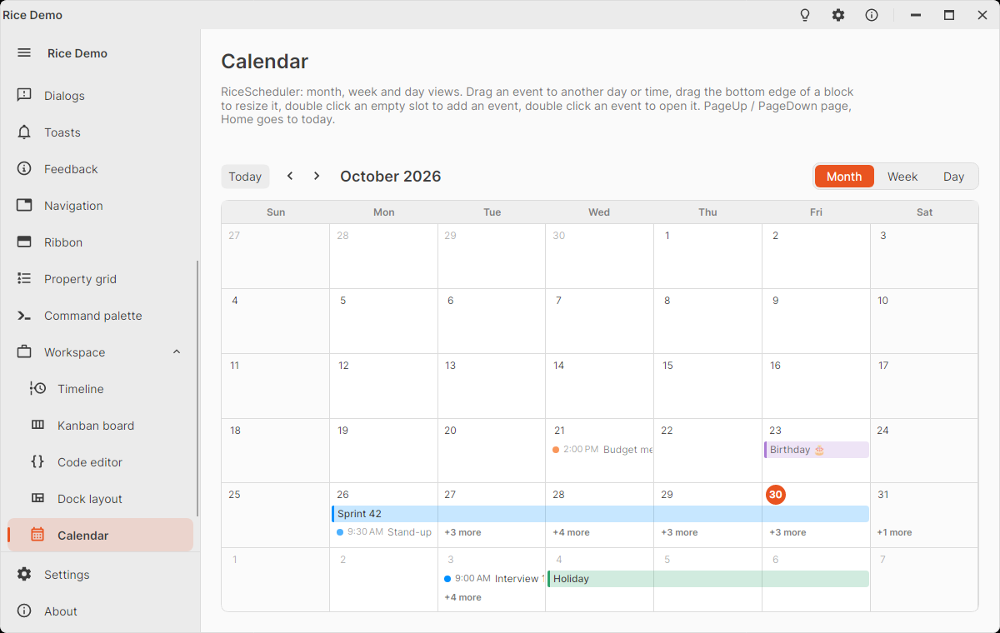

# RiceScheduler

Calendar of events with a month, a week and a day view, like the calendar of a mail client. The header has a Today
button, the previous / next arrows, the title of the shown period and a switch between the views.

<picture>
  <source media="(prefers-color-scheme: dark)" srcset="images/scheduler-dark.png" />
  
</picture>

- **Month**: six weeks; all day and multi day events are bars over their days, timed events a dot with the time and the
  title. A day with more events than fit shows "+n more"; it opens that day.
- **Week** and **Day**: the hours of the days, the timed events as blocks (overlapping events side by side), all day
  and multi day events in a strip above. The hours outside the working day and the weekends are shaded, today's column
  is tinted and a line marks the current time. Clicking a day's header opens that day.

```xml
<!-- xmlns:sched="clr-namespace:KD.Avalonia.Rice.Controls.Scheduling;assembly=KD.Avalonia.Rice" -->
<sched:RiceScheduler ItemsSource="{Binding Events}" ViewMode="Week" SelectedEvent="{Binding Selected}"
                     EventActivated="OnEventActivated" CreateEventRequested="OnCreateEvent" />
```

```csharp
Events.Add(new RiceCalendarEvent
{
    Title = "Design review",
    Start = new DateTime(2026, 10, 27, 10, 0, 0),
    End = new DateTime(2026, 10, 27, 11, 30, 0),
    Color = Brushes.MediumPurple,
    Tag = myMeeting,
});
// All day: from midnight to the next midnight (an End on the same day works too).
Events.Add(new RiceCalendarEvent { Title = "Holiday", Start = monday, End = monday.AddDays(3), IsAllDay = true });

private void OnCreateEvent(object? sender, RiceCalendarCreateEventArgs e) =>
    Events.Add(new RiceCalendarEvent { Title = "New event", Start = e.Start, End = e.End, IsAllDay = e.IsAllDay });
```

The events are `RiceCalendarEvent` objects (other items in `ItemsSource` are skipped); map your own records to them
and keep the record in `Tag`. An `ObservableCollection` is followed, and so are the changes of the events' properties.

## Editing with the mouse

- **Drag** an event to another day (month view, all day strip) or to another time and day (week and day views). Times
  move in steps of `SnapMinutes` (15); the block shows its new time while dragged. Escape cancels.
- **Resize** a block at its bottom edge (the cursor changes there).
- **Double click** an event: `EventActivated` (Enter on the selected event too), e.g. to open an editor.
- **Double click** an empty slot: `CreateEventRequested` with the half hour under the pointer and an hour after it, or
  the whole day (`IsAllDay`) in the month view and the all day strip. The scheduler adds nothing itself.

Before a drag or resize changes an event, `EventChanging` is raised (`e.Event`, `e.NewStart`, `e.NewEnd`): set
`e.Cancel = true` to keep it (e.g. a room that is booked), or `e.Handled = true` to change it yourself. Otherwise
`Start` and `End` are set and `EventChanged` follows. `ChangeEvent(event, start, end)` does the same from code.
`IsReadOnly` on the scheduler or on an event turns dragging off.

Keys (when the scheduler has the focus): PageUp / PageDown page back and forth, Home goes to today, Enter activates the
selected event.

## Properties

| Member | Default | Description |
|--------|---------|-------------|
| `ItemsSource` | `null` | The `RiceCalendarEvent`s. |
| `ViewMode` | `Month` | `Month`, `Week` or `Day` (two way; the header switch sets it). |
| `DisplayDate` | today | A day of the shown month / week, or the shown day (two way). |
| `FirstDayOfWeek` | culture | The first column of the weeks. |
| `SelectedEvent` | `null` | The clicked event (two way); drawn with a stronger tint and an outline. |
| `HourHeight` | `48` | Height of an hour in the week and day views (20–200). |
| `SnapMinutes` | `15` | Step of dragged and resized times (1–60). |
| `DayStartHour` | `7` | The hour the week and day views open scrolled to. |
| `WorkdayStartHour` / `WorkdayEndHour` | `8` / `18` | The working day; the other hours are shaded. |
| `IsReadOnly` | `false` | No dragging or resizing. |
| `Title` | | Read only: the title of the shown period. |
| `VisibleRange` | | The first day shown and the number of days. |
| `GoToToday()`, `Next()`, `Previous()` | | Navigation, like the header buttons. |

`RiceCalendarEvent`: `Title`, `Description` (in the tooltip), `Location`, `Start`, `End` (exclusive), `IsAllDay`,
`Color` (null: the accent), `IsReadOnly`, `Tag`; read only `FirstDay`, `LastDay`, `IsMultiDay`.

## Styling

The views are built from `RiceSchedulerDayCell` (pseudo classes `:today`, `:other-month`, `:weekend`, `:drop-target`)
and `RiceSchedulerEventChip` (`:bar`, `:dot`, `:block`, `:selected`, `:dragging`, `:past`, `:continues-before`,
`:continues-after`; `EventBrush` is the event's color). Brushes: `RiceSchedulerGridBrush` (half hour lines),
`RiceSchedulerOffHoursBrush`, `RiceSchedulerTodayBrush`, `RiceSchedulerNowBrush`. Texts: `RiceStrings.SchedulerToday`,
`SchedulerPrevious`, `SchedulerNext`, `SchedulerMonth`, `SchedulerWeek`, `SchedulerDay`, `SchedulerAllDay`,
`SchedulerMore`. Day and month names come from the current culture.
