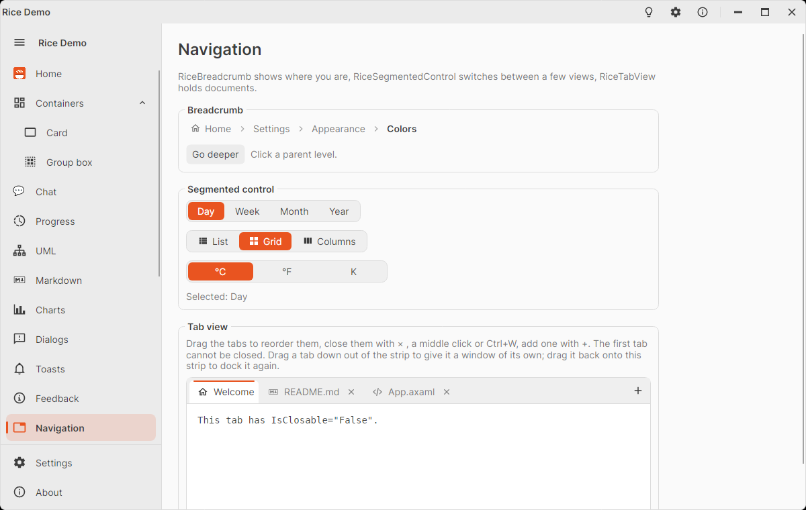

# RiceSegmentedControl

Row of 2–5 linked buttons of which exactly one is selected, like the linked buttons of GNOME / libadwaita: a view
switcher (Day / Week / Month), a filter, a unit picker. The selected segment takes the accent color.

<picture>
  <source media="(prefers-color-scheme: dark)" srcset="images/navigation-dark.png" />
  
</picture>

```xml
<rice:RiceSegmentedControl SelectedIndex="{Binding ViewIndex}">
  <rice:RiceSegmentedItem Content="Day" />
  <rice:RiceSegmentedItem Content="Week" />
  <rice:RiceSegmentedItem Content="Month" />
</rice:RiceSegmentedControl>

<rice:RiceSegmentedControl SelectedIndex="0">
  <rice:RiceSegmentedItem Icon="{x:Static icons:MaterialIconKind.ViewList}" Content="List" />
  <rice:RiceSegmentedItem Icon="{x:Static icons:MaterialIconKind.ViewGrid}" Content="Grid" />
</rice:RiceSegmentedControl>

<!-- Equal widths, e.g. for short labels. -->
<rice:RiceSegmentedControl IsEqualWidth="True" Width="240" ItemsSource="{Binding Units}" SelectedItem="{Binding Unit}" />
```

It is a `ListBox` underneath: bind `SelectedItem` / `SelectedIndex`, handle `SelectionChanged`, use `ItemsSource` with an
`ItemTemplate`. The selection mode defaults to `Single, AlwaysSelected`, so a click on the selected segment keeps it
selected and the first segment is selected when nothing else is. The arrow keys move the selection.

## Properties

| Property | Default | Description |
|----------|---------|-------------|
| `IsEqualWidth` | `false` | Gives every segment the width of the widest one (a one row `UniformGrid`). |
| `Background` | `RiceTrackBrush` | The track behind the segments. |
| `CornerRadius` | `8` | Of the track; the segments have `6`. |
| `HorizontalAlignment` | `Left` | Set `Stretch` (with `IsEqualWidth`) to fill the width. |

`RiceSegmentedItem` has an optional `Icon` (`IImage`, `MaterialIconKind`, string or control) before its content; an item
with only an icon (`Content` left empty, or a `MaterialIcon` as content) works too – add a `ToolTip.Tip`.
