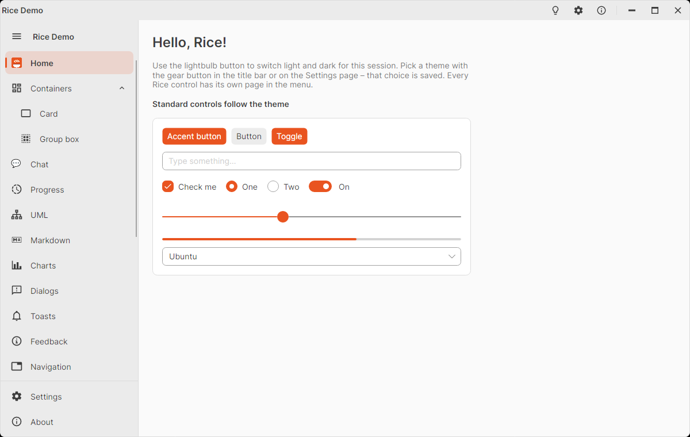
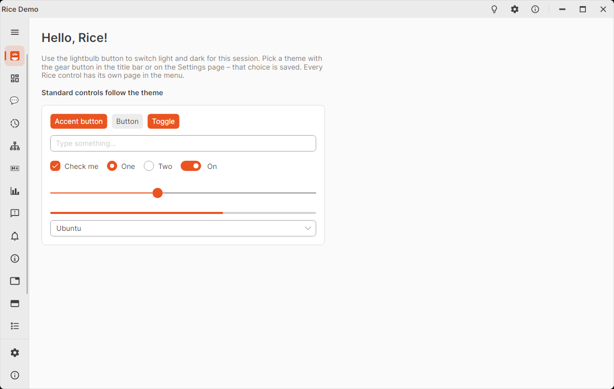

# RiceSideMenu

Navigation menu for the left side of a window: icon + text items with sub items, an optional header and footer and a
hamburger button that collapses the menu to its icons.

<picture>
  <source media="(prefers-color-scheme: dark)" srcset="images/home-dark.png" />
  
</picture>

<picture>
  <source media="(prefers-color-scheme: dark)" srcset="images/side-menu-collapsed-dark.png" />
  
</picture>

`RiceSideMenu` is a `TreeView` and its items (`RiceSideMenuItem`) are `TreeViewItem`s, so selection, keyboard
navigation and `ItemsSource` work the same way.

## Basic usage

```xml
<DockPanel>
  <rice:RiceSideMenu Name="SideMenu" DockPanel.Dock="Left" SelectionChanged="OnMenuSelectionChanged">
    <rice:RiceSideMenu.Header>
      <TextBlock FontWeight="SemiBold" Text="My App" TextTrimming="CharacterEllipsis" />
    </rice:RiceSideMenu.Header>

    <rice:RiceSideMenuItem Name="HomeItem" Icon="{x:Static icons:MaterialIconKind.HomeOutline}" Header="Home"
                           IsSelected="True" />
    <rice:RiceSideMenuItem Name="PhotosItem" Header="Photos">
      <rice:RiceSideMenuItem.Icon>
        <Image Source="/Assets/photos.png" />
      </rice:RiceSideMenuItem.Icon>
    </rice:RiceSideMenuItem>
    <rice:RiceSideMenuItem Name="ChatItem" Icon="💬" Header="Chat" />

    <rice:RiceSideMenu.Footer>
      <StackPanel>
        <rice:RiceSideMenuItem Icon="{x:Static icons:MaterialIconKind.CogOutline}" Header="Settings"
                               Click="OnSettingsClicked" />
      </StackPanel>
    </rice:RiceSideMenu.Footer>
  </rice:RiceSideMenu>

  <ContentControl Name="PageHost" />
</DockPanel>
```

```csharp
private void OnMenuSelectionChanged(object? sender, SelectionChangedEventArgs e)
{
    PageHost.Content = SideMenu.SelectedItem switch
    {
        _ when SideMenu.SelectedItem == PhotosItem => new PhotosPage(),
        _ when SideMenu.SelectedItem == ChatItem => new ChatPage(),
        _ => new HomePage(),
    };
}

// Footer items are not selectable: clear the selection while a footer page is shown.
private void OnSettingsClicked(object? sender, RoutedEventArgs e)
{
    SideMenu.SelectedItem = null;
    PageHost.Content = new SettingsPage();
}
```

## Icons

`Icon` accepts:

| Value | Example |
|-------|---------|
| `MaterialIconKind` | `Icon="{x:Static icons:MaterialIconKind.HomeOutline}"` |
| `IImage` (bitmap, SVG image, …) | `Icon="{Binding PhotoBitmap}"` |
| String (e.g. emoji) | `Icon="💬"` |
| Any control | `<rice:RiceSideMenuItem.Icon><Image Source="/Assets/photos.png" /></rice:RiceSideMenuItem.Icon>` |

The icon area is 20 × 20 px. The selected item's icon is drawn in the accent color when it uses the foreground
(Material icons, text); images keep their own colors.

## Sub items

Nest `RiceSideMenuItem`s to any depth:

```xml
<rice:RiceSideMenuItem Icon="{x:Static icons:MaterialIconKind.FolderOutline}" Header="Library" IsExpanded="True">
  <rice:RiceSideMenuItem Icon="{x:Static icons:MaterialIconKind.MusicNote}" Header="Music" />
  <rice:RiceSideMenuItem Icon="{x:Static icons:MaterialIconKind.Video}" Header="Videos">
    <rice:RiceSideMenuItem Header="Movies" />
    <rice:RiceSideMenuItem Header="Series" />
  </rice:RiceSideMenuItem>
</rice:RiceSideMenuItem>
```

- A parent item shows a chevron. Clicking it (or Enter / Space) expands or collapses it; it is **not** selected.
  `IsExpanded` sets the state (two-way bindable), `Expanded` / `Collapsed` events report changes.
- Sub items are indented by `Indent` (default 16 px) per level.
- Selecting a sub item (by click or from code) expands its parents.
- While a parent is closed and one of its sub items is selected, the parent shows the selection indicator
  (`HasSelectedChild`, `:childselected` pseudo class).
- When the menu is collapsed, sub items are hidden; clicking a parent opens the menu with that parent expanded.

## Collapsing

The hamburger button toggles `IsCollapsed`. Collapsed, the width animates from `ExpandedWidth` to `CollapsedWidth` and
only the icons are visible; items keep working and show their text (string `Header`) as tool tip.

```xml
<rice:RiceSideMenu IsCollapsed="{Binding MenuCollapsed}" ExpandedWidth="260" CollapsedWidth="56" />
```

- `IsCollapsed` is two-way by default and **inherited**: header and footer content can react to it, e.g.
  `IsVisible="{Binding !$parent[rice:RiceSideMenu].IsCollapsed}"`.
- `ShowCollapseButton="False"` hides the hamburger button (collapse from code with `IsCollapsed` / `ToggleCollapsed()`).
- `CollapsedChanged` is raised after every change.
- Keep `CollapsedWidth` at 56 unless you restyle the items: the icon column is 40 px plus 8 px padding on each side.

## Header and footer

- `Header` (top, next to the hamburger button) and `Footer` (bottom, separated by a line) take any content;
  `HeaderTemplate` / `FooterTemplate` are available for data. The header fades out when the menu collapses.
- `RiceSideMenuItem`s in the footer act as buttons: they raise `Click` and run `Command` / `CommandParameter`, but are
  never selected. Put several of them in a `StackPanel`.

## Binding to data (`ItemsSource`)

Use a `TreeDataTemplate` for the text and the sub items, and a style for the icon:

```xml
<rice:RiceSideMenu ItemsSource="{Binding Pages}" SelectedItem="{Binding SelectedPage}">
  <rice:RiceSideMenu.ItemTemplate>
    <TreeDataTemplate x:DataType="vm:PageViewModel" ItemsSource="{Binding Children}">
      <TextBlock Text="{Binding Title}" />
    </TreeDataTemplate>
  </rice:RiceSideMenu.ItemTemplate>
  <rice:RiceSideMenu.Styles>
    <Style Selector="rice|RiceSideMenuItem" x:DataType="vm:PageViewModel">
      <Setter Property="Icon" Value="{Binding Icon}" />
    </Style>
  </rice:RiceSideMenu.Styles>
</rice:RiceSideMenu>
```

```csharp
public partial class PageViewModel : ObservableObject
{
    public required string Title { get; init; }
    public MaterialIconKind Icon { get; init; }
    public ObservableCollection<PageViewModel> Children { get; } = [];
}
```

`SelectedItem` is then the view model. The automatic tool tip of the collapsed menu only works with a string `Header`;
for templated items set `ToolTip.Tip` in the style (`<Setter Property="ToolTip.Tip" Value="{Binding Title}" />`).
Programmatic selection expands the parents of items whose containers already exist (i.e. visible ones).

## Selection and keyboard

| Member | Description |
|--------|-------------|
| `SelectedItem` | The selected item (the `RiceSideMenuItem` itself, or the data item with `ItemsSource`). `null` clears. |
| `SelectionChanged` | Raised when the selection changes. |
| `IsSelected` (on the item) | Initial selection in XAML. |
| `SelectionMode` | `Single` by default; `Multiple` / `Toggle` work like in `TreeView`. |

Keyboard: ↑ / ↓ move the focus and the selection (parents only get the focus), → / ← expand / collapse a parent.
Enter and Space raise `Click` and run `Command`; on a parent they also expand / collapse it, on other items Space also
selects.

## RiceSideMenu properties

| Property | Default | Description |
|----------|---------|-------------|
| `IsCollapsed` | `false` | Only icons are shown. Two-way, inherited. |
| `ExpandedWidth` | `240` | Width when expanded. |
| `CollapsedWidth` | `56` | Width when collapsed. |
| `ShowCollapseButton` | `true` | Shows the hamburger button. |
| `Header`, `HeaderTemplate` | `null` | Content above the items. |
| `Footer`, `FooterTemplate` | `null` | Content below the items. |

Events: `CollapsedChanged`, `SelectionChanged`. Method: `ToggleCollapsed()`.

## RiceSideMenuItem properties

| Property | Default | Description |
|----------|---------|-------------|
| `Header` | `null` | Text (or any content) of the item. |
| `Icon` | `null` | See [Icons](#icons). |
| `IsSelected` | `false` | Selection state. |
| `IsExpanded` | `false` | Sub items are visible. |
| `Indent` | `16` | Indentation of the sub items per level (px). |
| `Command`, `CommandParameter` | `null` | Executed when the item is clicked or activated with Enter / Space. |
| `HasChildren` | – | Read-only: the item has sub items. |
| `HasSelectedChild` | – | Read-only: a sub item (at any depth) is selected. |

Events: `Click`, `Expanded`, `Collapsed`.

Pseudo classes for styling: `:selected`, `:expanded`, `:haschildren`, `:childselected`, `:collapsed`, `:pressed`.
Template parts: `PART_Header` (the row), `PART_Indicator`, `PART_IconPresenter`, `PART_HeaderPresenter`, `PART_Chevron`,
`PART_ItemsPresenter`.

## Migrating from the ListBox based menu

Earlier versions derived `RiceSideMenu` from `ListBox` and `RiceSideMenuItem` from `ListBoxItem`. Since sub items were
added they are a `TreeView` / `TreeViewItem`:

| Before | Now |
|--------|-----|
| `<rice:RiceSideMenuItem Content="Home" />` | `<rice:RiceSideMenuItem Header="Home" />` (also in the footer) |
| `SelectedIndex="0"` | `IsSelected="True"` on the item, or set `SelectedItem` |
| `SelectedIndex` in code | `SelectedItem` (the item, or the data item with `ItemsSource`) |
| `ItemsSource` + style binding `Content` | `ItemsSource` + `ItemTemplate` (`TreeDataTemplate`), or a style binding `Header` |
| Styles targeting `ListBoxItem` states on `PART_Background` | Target `RiceSideMenuItem` / `Border#PART_Header` (see [pseudo classes](#ricesidemenuitem-properties)) |

`SelectedItem`, `SelectionChanged`, `IsCollapsed`, `Header` / `Footer`, `Icon`, `Click` and `Command` work as before.

## Theme resources

`RiceSideMenuItemBackgroundBrush`, `RiceSideMenuItemHoverBrush`, `RiceSideMenuItemPressedBrush`,
`RiceSideMenuItemSelectedBrush`, `RiceSideMenuItemSelectedHoverBrush` (accent tints of the title bar color); the menu
uses `RiceTitleBarBackgroundBrush` / `RiceTitleBarForegroundBrush`. Texts: `RiceStrings.CollapseMenu`,
`RiceStrings.ExpandMenu` (hamburger tool tip).
