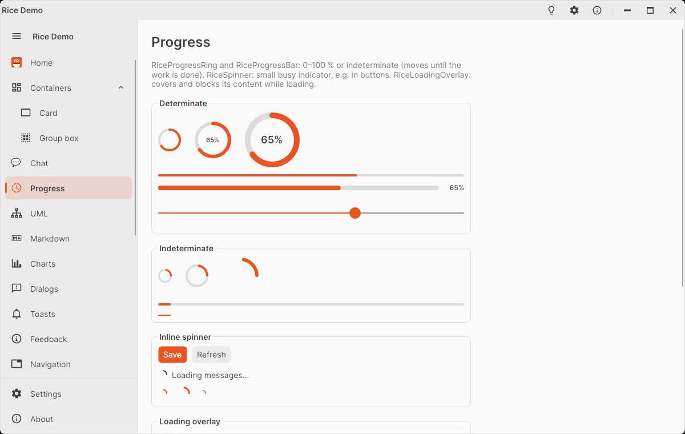

# RiceSpinner

Small busy indicator for inline use – inside a button next to its text, beside a status line, in a list row. It is a
spinning arc without a track, 16 × 16 px, in the **current text color**: `Foreground` is inherited, so it is white in
an accent button and follows the theme everywhere else. `IsActive="False"` hides it (it takes no space) and stops the
animation.

<picture>
  <source media="(prefers-color-scheme: dark)" srcset="images/progress-dark.png" />
  
</picture>

For a bigger indicator, a track or a percentage use [`RiceProgressRing`](rice-progress-ring.md); the spinner uses the
same animation.

```xml
<Button Classes="accent" Command="{Binding SaveCommand}">
  <StackPanel Orientation="Horizontal" Spacing="8">
    <rice:RiceSpinner IsActive="{Binding IsSaving}" />
    <TextBlock Text="Save" />
  </StackPanel>
</Button>
```

With CommunityToolkit.Mvvm, an async command reports its own state:

```xml
<rice:RiceSpinner IsActive="{Binding SaveCommand.IsRunning}" />
```

## Properties

| Property | Default | Description |
|----------|---------|-------------|
| `IsActive` | `true` | Spins and is visible; `false` hides it and stops the animation. |
| `Thickness` | `2` | Stroke width of the arc (px). |
| `Width`, `Height` | `16` | Size; the arc fits the smaller side. |
| `Foreground` | inherited | Color of the arc; set it for an accent or muted spinner. |

## Examples

Status line:

```xml
<StackPanel Orientation="Horizontal" Spacing="8">
  <rice:RiceSpinner IsActive="{Binding IsLoading}" />
  <TextBlock VerticalAlignment="Center" Text="Loading messages…" />
</StackPanel>
```

Other sizes and colors:

```xml
<rice:RiceSpinner Foreground="{DynamicResource RiceAccentBrush}" />
<rice:RiceSpinner Width="24" Height="24" Thickness="3" />
<rice:RiceSpinner Width="12" Height="12" Thickness="1.5" Foreground="{DynamicResource RiceForegroundMutedBrush}" />
```

## Tips

- **Busy buttons:** a disabled button draws its content in the disabled color, so the spinner turns gray. To keep the
  colors, leave the button enabled and ignore clicks while busy (a command's `CanExecute`, or
  `IsHitTestVisible="False"` plus a guard in the handler) – the demo's Progress page does this.
- To keep the button's width stable, reserve the spinner's space: wrap it in a `Panel Width="16"`, or swap the
  spinner and an icon (`IsVisible="{Binding !IsSaving}"` on the icon).
- The spinner is centered vertically by default (`VerticalAlignment="Center"`), so it lines up with text in a
  horizontal `StackPanel`.

## Styling

Pseudo class: `:active`. Template part: `PART_Ring` (an indeterminate `RiceProgressRing` with a transparent track).
