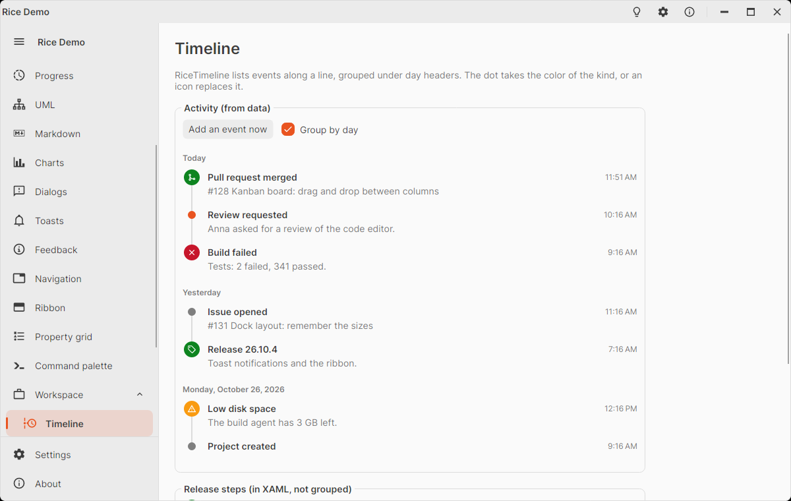

# RiceTimeline

Vertical list of events along a line, like an activity feed or the history of a ticket: every item has a dot (or an icon
in a filled circle) on the line, a title, a time and optional details. The items are grouped under day headers
("Today", "Yesterday", then the long date), and the line breaks between the days.

<picture>
  <source media="(prefers-color-scheme: dark)" srcset="images/timeline-dark.png" />
  
</picture>

```xml
<rice:RiceTimeline>
  <rice:RiceTimelineItem Header="Pull request merged" Kind="Success"
                         Icon="{x:Static icons:MaterialIconKind.SourceMerge}"
                         Timestamp="{Binding MergedAt}" Content="#128 Kanban board" />
  <rice:RiceTimelineItem Header="Review requested" Kind="Info" Timestamp="{Binding RequestedAt}">
    <TextBlock TextWrapping="Wrap" Text="Anna asked for a review of the code editor." />
  </rice:RiceTimelineItem>
</rice:RiceTimeline>
```

From data, the items get `RiceTimelineItem` containers; set their properties with a style:

```xml
<rice:RiceTimeline ItemsSource="{Binding Events}">
  <rice:RiceTimeline.Styles>
    <Style Selector="rice|RiceTimelineItem" x:DataType="vm:EventViewModel">
      <Setter Property="Header" Value="{Binding Title}" />
      <Setter Property="Content" Value="{Binding Details}" />
      <Setter Property="Timestamp" Value="{Binding When}" />
      <Setter Property="Kind" Value="{Binding Kind}" />
      <Setter Property="Icon" Value="{Binding Icon}" />
    </Style>
  </rice:RiceTimeline.Styles>
</rice:RiceTimeline>
```

The items are shown in the given order: sort them (newest or oldest first) before. Adding, removing and moving items in
an `ObservableCollection` updates the day headers. An item without a `Timestamp` stays in the day of the item before
it. It is an `ItemsControl` underneath: put it in a `ScrollViewer` when the list is long.

## Properties

`RiceTimeline`:

| Property | Default | Description |
|----------|---------|-------------|
| `GroupByDay` | `true` | Puts a day header above the first item of every day; `false`: one line, no headers. |
| `TimestampFormat` | `null` | Format of the times; `null`: `t` (the time) when grouped, `g` (date and time) when not. |

`RiceTimelineItem` (a `HeaderedContentControl`):

| Property | Default | Description |
|----------|---------|-------------|
| `Header` | | The title (bold). |
| `Content` | | Details below the title, in the muted color (text or any control). |
| `Timestamp` | `null` | `DateTime` of the event (local time); groups the items by day. |
| `Kind` | `Default` | Color of the dot: `Default` (neutral), `Info` (accent), `Success`, `Warning`, `Error` – the colors of the toasts. |
| `Icon` | `null` | `IImage`, `MaterialIconKind`, string or control in a filled circle instead of the dot. |
| `Actions` | `null` | Content at the right of the title, e.g. a button. |
| `KindBrush` | from `Kind` | Color of the dot / circle; set it for a color of your own. |

`DayHeader` and `TimestampText` are read only: the texts the timeline put on the item.
`RiceTimeline.DayHeader(day, today)` returns the header text of a day.

## Styling

`RiceTimelineItem` pseudo classes: `:first` / `:last` (the line starts / ends at the dot: the first and last item of a
day), `:has-icon`, `:info`, `:success`, `:warning`, `:error`. The line uses `BorderBrush` (`RiceBorderBrush`), the space
under an item is its `Padding` (`0,0,0,16`). Texts: `RiceStrings.TimelineToday`, `RiceStrings.TimelineYesterday`.
